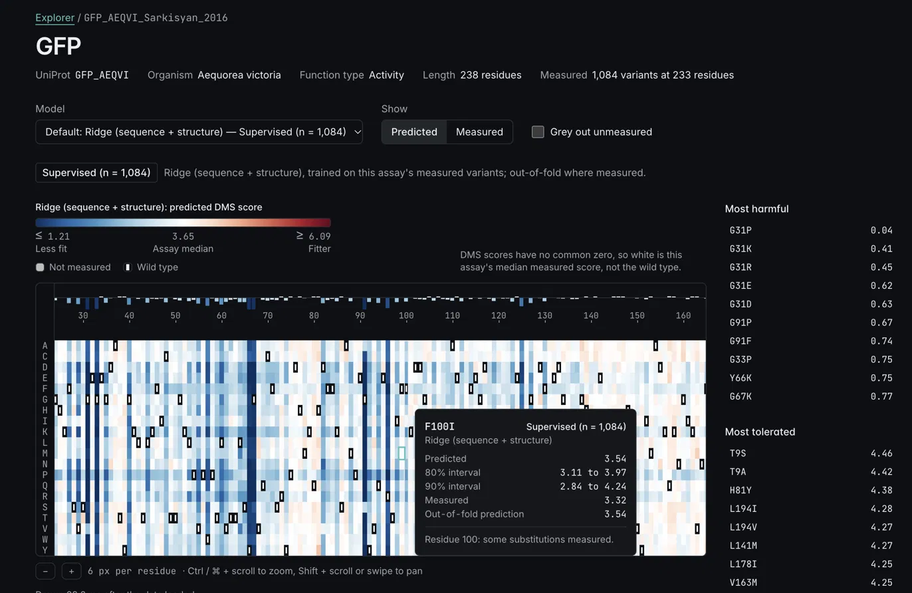
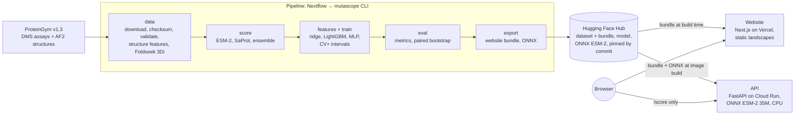

# MutaScope

**Live site: https://mutascope.abdullahhanif.me**



MutaScope predicts the functional effect of every single amino-acid substitution in a protein and
shows it as an interactive mutation landscape: a heatmap of all 19 × L substitutions, linked to
the protein's 3D structure. It covers the 217 deep mutational scanning (DMS) assays of the
ProteinGym v1.3 substitution benchmark, with zero-shot scores from protein language models
(ESM-2, and SaProt, which also reads the AF2 structure) and, where an assay has a structure and
enough measurements, a supervised model trained on that assay's own data, with prediction
intervals. Every model is benchmarked against the
measurements, ProteinGym's way, with paired bootstrap intervals for every comparison. You can
also paste any sequence and score it live with ESM-2 35M.

## Headline results

Spearman correlation between predicted and measured effect within an assay, aggregated over
assays as ProteinGym does (per protein, per function type, then overall). Each row is a paired
difference on the assays both models have, with its 95% paired bootstrap interval.

<!-- Every number below is a row of benchmarks.json in bundle-v1.1.0 (revision 1bfc294), the rows
the Landing and Benchmarks pages read (web/src/lib/benchmarks/select.ts), rounded as the pages
round them. The comment in each row names its source row. -->

| Comparison | Assays | Difference in Spearman | Paired 95% CI |
| --- | ---: | ---: | ---: |
| SaProt 650M − ESM-2 650M, zero-shot (adding structure tokens) | 213 | +0.046 | [+0.028, +0.062] <!-- zero_shot_comparisons: model_a=saprot_650m_af2, model_b=esm2_650m, split=null, metric=spearman, level=overall --> |
| Ensemble (ESM-2 650M + SaProt) − SaProt 650M, zero-shot | 213 | +0.006 | [−0.002, +0.014] <!-- zero_shot_comparisons: model_a=ensemble_esm2_650m_saprot_650m_af2, model_b=saprot_650m_af2, split=null, metric=spearman, level=overall --> |
| Supervised ridge (sequence + structure) − zero-shot SaProt, **contiguous** split | 213 | +0.092 | [+0.065, +0.115] <!-- supervised_comparisons: model_a=ridge_seq_struct, model_b=zero_shot_saprot_score, split=contiguous, metric=spearman, level=overall, group=null, size_bin=null --> |
| The same, modulo split | 213 | +0.135 | [+0.109, +0.156] <!-- supervised_comparisons: model_a=ridge_seq_struct, model_b=zero_shot_saprot_score, split=modulo, metric=spearman, level=overall, group=null, size_bin=null --> |

- Structure helps zero-shot: SaProt ranks variants better than ESM-2 650M of the same size.
- The ensemble is **not** shown to beat SaProt: its interval includes 0.
- The supervised model is trained per assay. The contiguous split holds out whole blocks of
  positions, so it measures prediction at residues the model never saw; it is the headline.
  On random folds, where the same positions appear in training, the gain is larger and less
  informative.
- Its 90% prediction intervals cover 90.8% of held-out measurements on average (contiguous
  split, split-matched calibration), and none of the 213 assays falls more than 10 points
  below target. <!-- calibration: scheme=contiguous, mode=scheme, level=0.9, size_bin=all; statistic=mean (0.9075), n_below (0), n_assays (213) -->

Each model on its own assays, for scale (these intervals describe one model each; compare models
only with the paired differences above):

| Model | Assays | Spearman | Own 95% CI |
| --- | ---: | ---: | ---: |
| ESM-2 35M, wild-type marginal (the method live fast mode uses) | 217 | 0.303 | [0.277, 0.329] <!-- zero_shot_summary: model=esm2_35m_wt, split=null, metric=spearman, level=overall, group=null --> |
| ESM-2 650M, zero-shot | 217 | 0.413 | [0.389, 0.441] <!-- zero_shot_summary: model=esm2_650m, split=null, metric=spearman, level=overall, group=null --> |
| SaProt 650M, zero-shot | 213 | 0.460 | [0.442, 0.483] <!-- zero_shot_summary: model=saprot_650m_af2, split=null, metric=spearman, level=overall, group=null --> |
| Supervised ridge (sequence + structure), contiguous split | 213 | 0.553 | [0.528, 0.581] <!-- supervised_summary: model=ridge_seq_struct, split=contiguous, metric=spearman, level=overall, group=null --> |

Every chart, split, function type and caveat is on the
[Benchmarks page](https://mutascope.abdullahhanif.me/benchmarks).

**Not for clinical use.** These are functional effects measured in laboratory DMS assays, not
pathogenicity, and nothing here is a clinical prediction.

## Architecture



- The website is static: every precomputed landscape, structure and benchmark number is a file of
  the published bundle, so the site works while the API is asleep.
- The API only scores sequences live. It never imports torch, runs one process on 2 vCPU, and
  scales to zero; the first request after idle takes about 20 s.
- Every pipeline step is a CLI command that reads and writes paths; Nextflow only calls them.
  Inputs are pinned and checksummed, and published files are pinned by Hub commit.
- Design decisions are recorded as ADRs in [docs/adr/](docs/adr/); the build log is in
  [docs/BUILD_LOG.md](docs/BUILD_LOG.md).

## Run it yourself

Requires [uv](https://docs.astral.sh/uv/) and Python 3.11. The pipeline also needs Nextflow
(Java 17+) and Foldseek ([install](docs/OPERATIONS.md#installing-foldseek)); the website needs
Node 24 and pnpm.

```bash
make setup           # uv sync --all-extras && pre-commit install
make lint test       # ruff, pyright, pytest (under 2 min, tiny model)
make pipeline-test   # the whole pipeline on 2 small assays with a 30 MB model
```

Both download the pinned ProteinGym v1.3 release into `data/raw/` first (checked against
`data/manifest.yaml`). The full pipeline (`make pipeline`) scores all 217 assays and takes
hours on a laptop: masked scoring with ESM-2 650M alone is about 1 h 41 min on an M4 Pro.

To run the API and the website locally:

```bash
make api                                  # http://localhost:7860/docs
cd web && pnpm install && pnpm data:fetch # the pinned bundle into web/public/data/
make web                                  # http://localhost:3000
```

The website calls the deployed API unless `NEXT_PUBLIC_MUTASCOPE_API_URL` points elsewhere.

Everything else (each pipeline step, resuming a long run, the model gate, experiment tracking,
the benchmark harness, figures, publishing, Docker, Foldseek) is in
[docs/OPERATIONS.md](docs/OPERATIONS.md).

## Links

| | |
| --- | --- |
| Website | https://mutascope.abdullahhanif.me |
| API docs (OpenAPI) | https://mutascope-api-2lvmztrsha-ew.a.run.app/docs |
| Dataset and website bundle | [`engAbdullahHanif/mutascope-proteingym-v1.3`](https://huggingface.co/datasets/engAbdullahHanif/mutascope-proteingym-v1.3) ([data card](docs/DATA_CARD.md), [bundle card](docs/BUNDLE_CARD.md)) |
| Supervised model | [`engAbdullahHanif/mutascope-ridge-seq-struct`](https://huggingface.co/engAbdullahHanif/mutascope-ridge-seq-struct) ([model card](docs/MODEL_CARD.md)) |
| ONNX ESM-2 (live scoring) | [`engAbdullahHanif/mutascope-esm2-onnx`](https://huggingface.co/engAbdullahHanif/mutascope-esm2-onnx) ([model card](docs/ONNX_MODEL_CARD.md)) |
| ProteinGym | https://proteingym.org |
| Roadmap | [docs/ROADMAP.md](docs/ROADMAP.md) |

Built with AI assistance (Claude); the design and decisions are my own.

## License

MutaScope is released under the [MIT License](LICENSE). The processed dataset derived from
ProteinGym v1.3 is also MIT-licensed, matching ProteinGym's own licence. When you use specific
assays, please also cite ProteinGym and the original studies
([docs/DATA_CARD.md](docs/DATA_CARD.md)).
