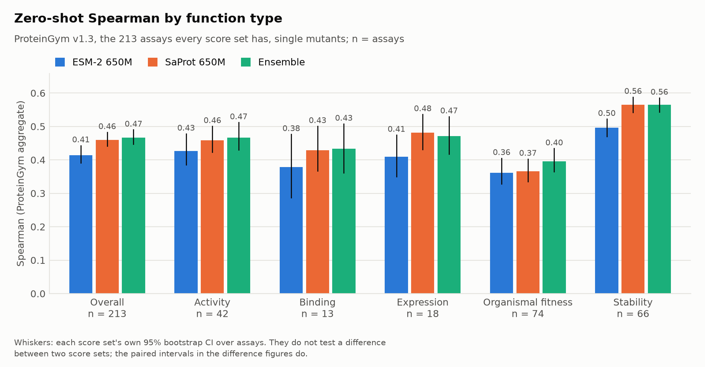

# MutaScope

Predicts the functional effect of every single amino-acid substitution in a protein and presents it as an
interactive mutation landscape, with an honest benchmark on ProteinGym DMS assays.

Status: early development (Phase 4, API, Docker and CI/CD; the zero-shot benchmark is summarised in
[ADR 0017](docs/adr/0017-phase-2-close.md), the supervised models in [ADR 0026](docs/adr/0026-phase-3-close.md)). See [docs/ROADMAP.md](docs/ROADMAP.md).

## Quick start

```bash
make setup   # uv sync --all-extras && pre-commit install
make lint test
make pipeline
```

Requires [uv](https://docs.astral.sh/uv/), Nextflow (Java 17+) and Foldseek (see below).

## Running the pipeline

`pipeline/main.nf` chains the `mutascope` commands
([ADR 0007](docs/adr/0007-pipeline-wiring-and-ci.md)):

```
DOWNLOAD -> [SUBSET] -> VALIDATE -> CLEAN, STRUCT_FEATURES, FOLDSEEK_3DI -> STRUCTURE_REPORT
                   CLEAN, STRUCT_FEATURES, FOLDSEEK_3DI -> SCORE_ZERO_SHOT -> BENCHMARK_ZERO_SHOT
```

- `make pipeline` runs on all 217 assays. The release is downloaded once into `data/raw/` and
  re-verified against `data/manifest.yaml` on every run. Outputs go to
  `data/processed/{variants,structure_features,three_di}/`, and reports (validation, cleaning,
  structure) go to `results/data/`.
- `SCORE_ZERO_SHOT` scores every assay's single mutants, once per model and scoring method:
  ESM-2 35M, 150M and 650M, each with the masked marginal and the wild-type marginal
  (`--models esm2_650m --methods masked` narrows it). A score set is written to
  `data/processed/zero_shot/<label>/`, where the label is the model name, plus `_wt` for the
  wild-type marginal. Masked scoring covers only the positions each assay measures and is the
  long step: about 1 h 41 min for 650M, 29 min for 150M and 19 min for 35M on an M4 Pro, against
  under 30 s per model for the wild-type marginal. On a laptop, run it as `caffeinate -ims make pipeline` so the
  machine does not sleep, and do not run anything else on the GPU meanwhile.
- SaProt 650M (`saprot_650m_af2`, masked marginal only) is scored on the 213 assays with an AF2
  structure, on the residues the structure models, in one pass per position without windows
  (ADR 0015). It reads its structure tokens from `processed/three_di` and
  `processed/structure_features` and takes about 1 h 45 min. Its results state 213 assays, and
  `mutascope eval compare` compares it with ESM-2 650M on those 213.
- `BENCHMARK_ZERO_SHOT` turns each score set into `results/zero_shot_<label>_single.parquet`
  (per assay) and `..._summary.parquet` (ProteinGym-style aggregates with bootstrap CIs).
- `LANDSCAPES` then fills in every residue of every assay, once per model, in the same cache
  (`mutascope score landscapes`), and `CHECK_LANDSCAPES` fails unless every landscape is a
  complete `(L, 20)` array (`mutascope score check-landscapes`, no model loaded). An assay whose
  benchmark region is part of its target (five MSA-region assays for ESM-2, three
  partial-structure assays for SaProt) also gets a full-target landscape, labelled `full`
  ([ADR 0018](docs/adr/0018-full-landscapes.md)). On an empty cache this is about 11 h 20 min of
  model time (SaProt 7 h 11 min); `--landscapes false` skips both steps.
- `make pipeline-test` runs the same steps on 2 small assays, with the 30 MB `esm2_t6_8M`
  model and both methods, and skips the 1.9 GB zero-shot archive. It writes only to `pipeline/results/`
  (gitignored), taking about 30 s from an empty cache. CI runs it on every push.
- `make pipeline-test-docker` runs the same smoke test in the pipeline image (`-profile
  docker,test`; CPU-only torch and the pinned Foldseek; build it once with `make
  pipeline-image`). Data, caches and outputs stay on the host, mounted at their own paths
  ([ADR 0033](docs/adr/0033-docker-images.md)).

### Resuming an interrupted scoring run

Run the same command again. Every scored sequence is written to `data/cache/logprobs/` as soon
as it is finished, and that directory is outside Nextflow's work directory, so a rerun (with or
without `-resume`) reads finished assays from disk and runs the model only for the rest. At most
the one sequence in progress is lost, which is under 7 minutes of work. The command prints how
many assays came from the cache, and `results/data/zero_shot_run_<label>.parquet` records
`positions_computed` per assay (0 = read from the cache)
([ADR 0013](docs/adr/0013-benchmark-scoring-run.md)).

`score landscapes` goes further: it writes the cache every `scoring.landscapes.checkpoint_tokens`
of model work (under a minute on the 650M models), also inside one long protein, so a stop at
any moment loses less than a minute. It logs `landscape_progress` after every write with the
positions done, the share of the work and the estimated time remaining.

### The model gate

```bash
uv run mutascope eval model-gate \
    --scores-dir data/processed/zero_shot/esm2_650m \
    --precomputed-dir data/raw/proteingym_v1.3/zero_shot_substitutions_scores \
    --reference data/raw/proteingym_v1.3/DMS_substitutions.csv --out-dir results
```

compares our scores with ProteinGym's precomputed `ESM2_650M` on the 696,311 single mutants
(ADR 0010) and exits 1 if any assay has per-variant Spearman below 0.99 or the aggregate differs
by more than 0.01. `make test-slow` runs the same check as a test. Add `model=esm2_35m` or
`model=esm2_150m` (and their score directories) to gate the smaller checkpoints against
`ESM2_35M` and `ESM2_150M`. The gate applies to masked marginals only: ProteinGym publishes no
wild-type-marginal ESM-2 scores.

`model=saprot_650m_af2` gates SaProt against `SaProt_650M_AF2` on the 213 assays with a
structure. Two of them are documented exceptions in `conf/eval/model_gate.yaml`: ProteinGym's
scores for `POLG_HCVJF_Qi_2014` and `BRCA2_HUMAN_Erwood_2022_HEK293T` were made from wrong
inputs (ADR 0015), which two slow tests show by reproducing them from those inputs. The gate
covers the other 211 and fails if a listed assay starts to agree.

### Experiment tracking

Every `score zero-shot`, `eval zero-shot` and `eval model-gate` invocation logs one run to a
local MLflow store, `mlruns/mlflow.db` plus `mlruns/artifacts/` (gitignored; no server and no
account). A run holds the model name, Hub id and pinned revision, the scoring method, the git
commit of the code, the full resolved config (`config.yaml`), the metrics, and the files the
command wrote ([ADR 0014](docs/adr/0014-model-sizes-wt-marginal-tracking.md)).

```bash
make mlflow          # UI on http://127.0.0.1:5001
```

`tracking.enabled=false` turns it off, and `tracking.dir=<path>` moves the store. MLflow is the
`tracking` extra, which `make setup` installs.

Hydra overrides reach every command through `--hydra_overrides`, for example
`nextflow run pipeline/main.nf -profile local --hydra_overrides 'structure.foldseek.threads=8'`.

## Exploring the data

```bash
uv run marimo edit notebooks/eda.py
```

The notebook shows assay sizes, function types, score distributions and sequence lengths for
the processed data (run `make pipeline` first). All of its tables and charts come from
`mutascope.eda`. [docs/DATA_CARD.md](docs/DATA_CARD.md) describes the dataset.

## Benchmark harness

`mutascope eval` scores predictions per assay (Spearman, AUC, MCC, NDCG@10%, top-10% recall)
and aggregates them as ProteinGym does: per UniProt ID and function type, then per function type,
then overall, with bootstrap 95% CIs over assays
([ADR 0011](docs/adr/0011-benchmark-harness.md)). Run it on ProteinGym's own precomputed scores
to check the harness against the published leaderboard:

```bash
R=data/raw/proteingym_v1.3
uv run mutascope eval precomputed --scores-dir $R/zero_shot_substitutions_scores \
    --reference $R/DMS_substitutions.csv --rows all --out-dir results
uv run mutascope eval compare-leaderboard --results results/proteingym_precomputed_all.parquet
```

`--rows all` scores single and multi-mutants, as the leaderboard does; `--rows single` scores
the 696,311 single mutants MutaScope uses. The harness gate in `tests/test_reproduction.py` runs
the same comparison as a test whenever the release is downloaded.

### Comparing models

```bash
uv run mutascope eval compare --results-dir results \
    --reference data/raw/proteingym_v1.3/DMS_substitutions.csv \
    --out results/zero_shot/comparisons.parquet
```

runs a paired bootstrap for every pair in `eval.comparisons`: each resample draws one set of
assays, applies it to both score sets and recomputes the full aggregate, so the CI is of the
difference itself. Two models scored on the same assays share most of their assay-to-assay
spread, so their separate CIs overlap even when one is clearly better; comparisons are read
from this file, never from two separate intervals
([ADR 0014](docs/adr/0014-model-sizes-wt-marginal-tracking.md)).

### Ensemble

```bash
E=ensemble_esm2_650m_saprot_650m_af2
uv run mutascope score ensemble --scores-root data/processed/zero_shot \
    --reference data/raw/proteingym_v1.3/DMS_substitutions.csv \
    --out-dir data/processed/zero_shot model=$E
uv run mutascope eval zero-shot --scores-dir data/processed/zero_shot/$E \
    --variants-dir data/processed/variants \
    --reference data/raw/proteingym_v1.3/DMS_substitutions.csv --out-dir results model=$E
```

builds the ensemble of ESM-2 650M and SaProt from their written scores: each member's scores
are z-scored within an assay, then averaged ([ADR 0016](docs/adr/0016-ensemble-and-figures.md)).
No model runs. It covers the 213 assays both members have. On those assays its Spearman is
0.4663, against 0.4600 for SaProt and 0.4144 for ESM-2 650M. The paired difference is +0.0519
(95% CI +0.0419 to +0.0615) over ESM-2 650M and +0.0063 (−0.0018 to +0.0145) over SaProt: the
ensemble is clearly better than ESM-2, and not shown to be better than SaProt.

### Figures

```bash
uv run mutascope eval shared --results-dir results \
    --reference data/raw/proteingym_v1.3/DMS_substitutions.csv \
    --out results/zero_shot/shared_summary.parquet
uv run mutascope eval figures --results-dir results \
    --comparisons results/zero_shot/comparisons.parquet \
    --shared-summary results/zero_shot/shared_summary.parquet --out-dir results/figures
```

`eval shared` summarises the score sets in `eval.shared_summary` again on the assays all of
them have, so they can be drawn side by side. `eval figures` then draws four figures as SVG and
PNG, reading results files only (`conf/eval/figures.yaml` says what each shows):

| Figure | Shows |
|---|---|
| [`model_size_vs_spearman`](results/figures/model_size_vs_spearman.svg) | ESM-2 35M, 150M and 650M on 217 assays, with the paired difference of each size step |
| [`function_type_spearman`](results/figures/function_type_spearman.svg) | ESM-2 650M, SaProt and the ensemble per function type, on the 213 shared assays |
| [`ensemble_gain`](results/figures/ensemble_gain.svg) | Ensemble minus each member, with paired CIs |
| [`fast_vs_masked`](results/figures/fast_vs_masked.svg) | Masked minus wild-type marginal for the three ESM-2 sizes, with paired CIs |

Grey whiskers are a score set's own CI and do not compare two score sets; coloured intervals
are paired-bootstrap CIs of a difference. Zero-shot results on DMS assays: they describe
functional effect in those assays, not pathogenicity. matplotlib is the `figures` extra, which
`make setup` installs.



## Publishing the dataset

The processed dataset is on the Hugging Face Hub as
[`engAbdullahHanif/mutascope-proteingym-v1.3`](https://huggingface.co/datasets/engAbdullahHanif/mutascope-proteingym-v1.3)
(`publish.repo_id` in `conf/publish/hub.yaml`).

`uv run mutascope data publish` stages the Hub copy in `build/hf_dataset/` (Parquet tables,
reports, card, `provenance.json`, `SHA256SUMS`) without uploading anything. To upload it, with a
write token in `HF_TOKEN`:

```bash
uv run mutascope data publish --push
```

A new repo is created private; an existing one keeps its visibility
([ADR 0008](docs/adr/0008-eda-and-hub-publication.md)).

## Docker

Two images ([ADR 0033](docs/adr/0033-docker-images.md)), built from the repository root:

```bash
make api-image                          # mutascope-api:dev, this machine's architecture
make api-image PLATFORM=linux/amd64     # the Space's
docker compose up                       # http://localhost:7860/docs; settings from .env
make test-container                     # the image under the Space's limits (2 CPUs, 16 GB)
make pipeline-image                     # mutascope-pipeline:dev, for -profile docker
```

The API image has no torch or transformers. It holds the website bundle and the fp32 ONNX
models, fetched at the pinned commits and checked against their `SHA256SUMS` when the image is
built. It runs offline as UID 1000, as one process (`python -m api.app.serve`), on port 7860.
Settings are `MUTASCOPE_API_*` environment variables, all listed in `.env.example`. Copy it to
`.env` for `docker compose`. Never put a secret in the image or in a committed file.

The package's dependencies are split so that the API image can leave torch out: `mutascope`
alone is the base the API imports, and `mutascope[pipeline]` is what the pipeline and the CLI
need. `make setup` installs every extra.

## Installing Foldseek

`mutascope data foldseek-3di` needs [Foldseek](https://github.com/steineggerlab/foldseek) release
**`10-941cd33`** exactly: 3Di tokens depend on the build, so any other version is refused
([ADR 0006](docs/adr/0006-structure-features.md)). Homebrew has no `foldseek` formula (checked
2026-10-10), so install the official release binary:

```bash
# macOS (universal). On Linux/amd64 (CI, Docker) use foldseek-linux-avx2.tar.gz instead.
curl -LO https://github.com/steineggerlab/foldseek/releases/download/10-941cd33/foldseek-osx-universal.tar.gz
shasum -a 256 foldseek-osx-universal.tar.gz
# expect 6d8b07e188d443044f0c98db30aa3d4cca6750e97b50679372b54b45a664cae5
tar xzf foldseek-osx-universal.tar.gz
sudo install -m 755 foldseek/bin/foldseek /usr/local/bin/foldseek   # any directory on PATH works
foldseek version   # must print 941cd33ff0771cd2e3f144e3293e22a2b87e9fda
```

The command finds the binary in this order:

1. `FOLDSEEK_BIN`, if set (for example `export FOLDSEEK_BIN=$HOME/tools/foldseek`). It must be an
   executable file.
2. Otherwise, `foldseek` on `PATH`.

If neither is found, the command fails before doing any work and points here. The structure
report (`results/data/structure_report.md`) records the binary it used by version, sha256 and
how it was found (`FOLDSEEK_BIN` or `PATH`), never by path, so the report is identical on any
machine. The full path is kept only in `<three_di dir>/foldseek_run.json`, under the gitignored
`data/`, for local debugging. The macOS binary
above has sha256 `1b446bbece6b01cf0a50b28419f353522204f44a10a5872462f8ad400d9aadab`. Without
Foldseek, `make test` still passes, because one golden test is skipped.

## License

MutaScope is released under the [MIT License](LICENSE). The processed dataset derived from
ProteinGym v1.3 is also MIT-licensed, matching ProteinGym's own licence. When you use specific
assays, please also cite ProteinGym and the original studies
([docs/DATA_CARD.md](docs/DATA_CARD.md)).
